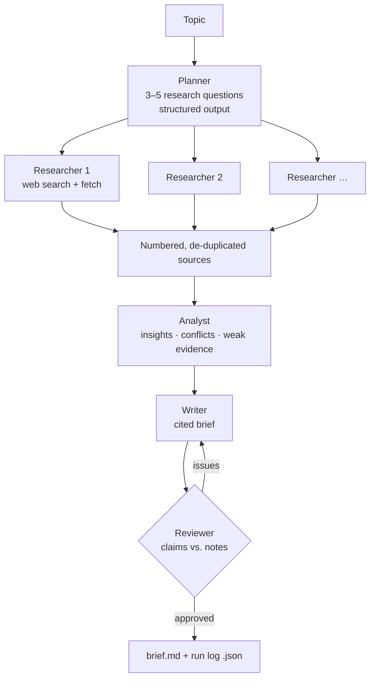

# Multi-Agent Research Crew


Give it a topic, like *"the market for AI coding assistants in 2026"*, and a team of specialised Claude
agents plans the research, searches the web in parallel, reconciles what they find, writes an executive
brief with numbered citations, and has it fact-checked before you see it.

## The team



- **Orchestrator-worker pattern** ([`crew.py`](src/research_crew/crew.py)): one planner fans out to parallel
  researchers; each role has its own focused prompt and effort level (low for search, high for synthesis)
- **Grounded in sources**: researchers use Claude's server-side web search and fetch tools;
  citations are collected from the API response, de-duplicated and numbered across the whole crew
- **Built-in fact-checking**: a reviewer compares every claim in the draft with the research notes, and
  the writer revises once if anything is unsupported
- **Production details**: `pause_turn` resumption for long server-side searches, thread-safe cost
  tracking, a JSON run log of the plan, notes and review for every brief
- **Tested offline** with a scripted fake client that routes responses by agent role

## Run it

```bash
make setup                 # install dependencies (requires uv)
cp .env.example .env       # add ANTHROPIC_API_KEY (a .env in any parent folder also works)
make brief T="The market for AI coding assistants in 2026"
make test                  # offline tests
```

A brief typically takes 2–4 minutes. The cost shown covers tokens only; web searches are billed
separately by the API (about $10 per 1,000 searches, at most 5 per researcher here).

**Stack:** Python · Claude API (server-side web search & fetch, structured outputs, citations) · Pydantic · Rich · pytest
